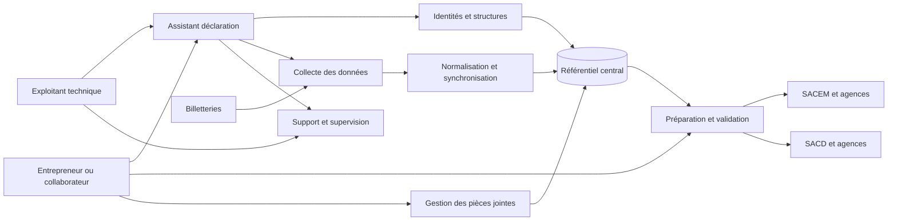

# Architecture logique — Assistant déclaration

## Objet du document

Ce volet du Document d’Architecture Technique décrit les fonctions de la solution, les responsabilités de ses briques et leurs échanges, indépendamment autant que possible des choix de mise en œuvre. Les détails des composants logiciels et des flux sont présentés dans [l’architecture technique](./architecture-technique.md) ; les ressources d’hébergement sont présentées dans [l’architecture physique](./architecture-physique.md).

L’analyse repose sur le code et la documentation versionnés dans le dépôt, notamment le modèle de données, les parcours applicatifs, les connecteurs et l’ancien `TECHNICAL_ARCHITECTURE_DOCUMENT.md`.

## Périmètre fonctionnel

### Finalité

Assistant déclaration est un service public numérique destiné aux entrepreneurs du spectacle vivant. Il récupère, lorsque l’utilisateur l’autorise, des données déjà présentes dans ses systèmes de billetterie afin de préremplir une déclaration, permet leur vérification ou leur correction, puis transmet la déclaration aux organismes concernés.

Le modèle courant couvre les déclarations SACEM et SACD. Une même série de représentations peut être destinée à un ou plusieurs de ces organismes.

### Profils d’utilisateurs

| Profil                                       | Capacités constatées                                                                                                                                                                                                                   |
| -------------------------------------------- | -------------------------------------------------------------------------------------------------------------------------------------------------------------------------------------------------------------------------------------- |
| Visiteur                                     | Consulter les pages publiques, la documentation de raccordement, les mentions de conformité et créer ou confirmer un compte.                                                                                                           |
| Utilisateur authentifié                      | Gérer son profil et son mot de passe, créer sa structure, accéder aux structures dont il est collaborateur et solliciter le support.                                                                                                   |
| Collaborateur d’une structure / entrepreneur | Raccorder les billetteries de sa structure, lancer une synchronisation, gérer les séries et représentations, compléter les données déclaratives, joindre des documents et transmettre les déclarations.                                |

### Fonctions couvertes

- création, confirmation et authentification d’un compte par courriel et mot de passe ; récupération et changement du mot de passe ;
- création d’une structure à partir de son établissement, avec vérification dans l’Annuaire des Entreprises et résolution d’adresse ;
- raccordement de Billetweb, HelloAsso, Mapado, Shotgun, SoTicket ou Supersoniks au moyen d’identifiants propres au fournisseur ;
- saisie manuelle d’une série de représentations, sans raccordement à une billetterie ;
- lecture des données de billetterie, normalisation dans un modèle commun et synchronisation différentielle ;
- vérification et correction des séries, représentations, recettes, dépenses, lieux, jauges, producteurs et pièces jointes ;
- préparation d’une déclaration unique, puis validation selon les règles propres à chaque organisme ;
- transmission à la SACD par interface applicative et envoi séparé de certaines pièces jointes par courriel ;
- production d’un PDF et envoi par courriel à l’agence SACEM déterminée par le code postal ;
- suivi de l’état et des erreurs de synchronisation ou de transmission ;
- aide en ligne, mesure d’audience et support conversationnel.

## Principes d’architecture logique

1. **Séparation en couches dans une application unique.** Les écrans et composants d’interface appellent des procédures applicatives. Celles-ci portent les contrôles d’accès et orchestrent les règles métier, les adaptateurs externes et la persistance.
2. **Référentiel applicatif central.** Les comptes, structures, raccordements, séries, représentations, déclarations, pièces jointes et référentiels d’agences sont centralisés dans une base relationnelle.
3. **Adaptation des billetteries à un modèle commun.** Chaque billetterie dispose d’un connecteur qui restitue des séries et représentations normalisées. SoTicket réutilise le connecteur Supersoniks ; certaines billetteries ne possédant pas la notion de série sont adaptées au modèle interne.
4. **Séparation entre collecte et déclaration.** Les données importées peuvent être vérifiées et complétées avant transmission. Une synchronisation ne réécrit pas une série déjà engagée dans une déclaration, ni une donnée de billetterie corrigée manuellement au niveau d’une représentation.
5. **Contrôle par structure.** Les opérations métier vérifient que l’utilisateur est collaborateur de la structure visée. Les identifiants propres à chaque billetterie sont isolés par raccordement et par structure.
6. **Traitements principalement synchrones.** La synchronisation de billetterie et la transmission des déclarations sont exécutées dans la requête utilisateur. La synchronisation émet périodiquement une réponse pour éviter le délai d’expiration de la plateforme. La file de travaux persistante ne porte actuellement que le nettoyage planifié des téléversements incomplets.
7. **Transmission spécialisée par organisme.** Une déclaration SACD est transmise à une interface dédiée ; une déclaration SACEM est rendue en PDF puis envoyée par courriel à l’agence compétente. Il n’existe donc pas de protocole déclaratif générique unique.
8. **Fonctionnement protégé hors production.** En dehors du mode production, les appels aux billetteries et à la SACD sont simulés par défaut, sauf activation explicite pour certains utilisateurs.

## Briques fonctionnelles

| Brique fonctionnelle             | Responsabilité                                                                                                          | Entrées                                                                        | Sorties                                                        | Interactions                                                |
| -------------------------------- | ----------------------------------------------------------------------------------------------------------------------- | ------------------------------------------------------------------------------ | -------------------------------------------------------------- | ----------------------------------------------------------- |
| Gestion des identités            | Inscription, confirmation, connexion, récupération et changement du mot de passe, profil                                | Identité, courriel, mot de passe, jetons temporaires                           | Compte confirmé, session, courriels transactionnels            | Messagerie, référentiel des utilisateurs                    |
| Gestion des structures           | Créer la structure déclarante et associer ses collaborateurs                                                            | SIRET d’établissement, nom, utilisateur                                        | Structure, siège et appartenance                               | Annuaire des Entreprises, Base Adresse Nationale, identités |
| Raccordements de billetterie     | Enregistrer, tester, modifier ou désactiver les accès aux billetteries                                                  | Type de billetterie, identifiants d’accès                                      | Raccordement validé, état de traitement                        | Structures, connecteurs de billetterie                      |
| Collecte de billetterie          | Lire les données des fournisseurs ou accepter une saisie manuelle                                                       | Raccordements, date de dernière synchronisation, saisie utilisateur            | Données brutes adaptées au modèle commun                       | Billetteries, normalisation                                 |
| Normalisation et synchronisation | Comparer les données reçues au référentiel, créer ou mettre à jour séries et représentations, préserver les corrections | Séries et ventes issues des connecteurs                                        | Séries, représentations, recettes, taxes, compteurs de billets | Collecte, stockage, préparation des déclarations            |
| Préparation des déclarations     | Compléter et valider les informations communes et propres à la SACEM ou à la SACD                                       | Données de billetterie, structure, lieux, dépenses, producteur, pièces jointes | Déclaration cohérente par organisme                            | Référentiel métier, stockage documentaire                   |
| Transmission SACEM               | Choisir l’agence, produire le PDF et envoyer la déclaration et les pièces utiles                                        | Déclaration validée, référentiel des agences SACEM                             | Courriel et PDF, état de transmission                          | Messagerie, agence SACEM, suivi                             |
| Transmission SACD                | Authentifier l’application auprès de la SACD, transmettre les données puis envoyer les pièces utiles à l’agence         | Déclaration validée, référentiel des agences SACD, pièces jointes              | Déclaration distante, courriel éventuel, état de transmission  | Système SACD, messagerie, agence SACD, suivi                |
| Gestion documentaire             | Téléverser, contrôler, conserver et délivrer temporairement les pièces jointes privées                                  | Fichier, type, association à une série                                         | Pièce jointe en base, lien signé à durée limitée               | Préparation, stockage, nettoyage planifié                   |
| Support et mesure d’audience     | Assistance utilisateur et mesure de l’usage                                                                             | Navigation, identité signée pour le support                                    | Événements de mesure et conversation                           | Matomo, Crisp                                               |
| Exploitation et maintenance      | Initialiser les traitements, appliquer les migrations, charger les référentiels et rejouer un travail terminé           | Commandes d’exploitation, clé de maintenance, fichiers d’agences               | Base à jour, travaux planifiés ou rejoués                      | Base, file de travaux, journalisation, Sentry               |

## Schéma d’architecture logique

## Interactions internes et externes

### Échanges internes

- L’interface utilisateur appelle les procédures applicatives pour lire ou modifier les données ; les réponses et erreurs métier sont typées et validées.
- La couche applicative contrôle l’authentification, puis l’appartenance à la structure avant d’accéder aux séries, déclarations et raccordements.
- Les connecteurs traduisent les modèles propres aux billetteries vers les entités communes « série de représentations » et « représentation ».
- La synchronisation compare l’état distant et l’état local dans une transaction ; un verrou transactionnel par structure interdit deux synchronisations concurrentes.
- La préparation consolide les données communes puis applique les validations SACEM et SACD avant tout envoi.
- Les fichiers transitent temporairement par le système de fichiers du processus, puis sont conservés en base et associés à la série. Les fichiers non associés sont supprimés par un traitement planifié.

### Échanges avec les billetteries

Les connecteurs Billetweb, HelloAsso, Mapado, Shotgun, SoTicket et Supersoniks vérifient les identifiants puis lisent les événements, ventes, tarifs et taxes disponibles. Les données exactes et les règles de pagination varient selon le fournisseur. Aucun envoi de données métier vers les billetteries n’a été identifié, hors informations nécessaires à l’authentification de leurs interfaces.

### Échanges avec les organismes de déclaration

- **SACD :** ouverture d’une session auprès de l’interface de la SACD, transformation de la déclaration dans le format attendu, transmission et interprétation des résultats par représentation. Certaines pièces jointes sont adressées séparément par courriel à l’agence déterminée à partir du code postal.
- **SACEM :** recherche de l’agence à partir du code postal, génération d’un document PDF et envoi par courriel avec les pièces jointes pertinentes. Le courriel de l’utilisateur est positionné comme adresse de réponse.

Les correspondances entre codes postaux et agences proviennent de fichiers confidentiels fournis par les organismes et chargés manuellement en base.

### Services nécessaires au fonctionnement

La création de structure dépend de l’Annuaire des Entreprises et du service national de géocodage. Les courriels de compte et de déclaration dépendent d’un serveur SMTP principal et d’un serveur de repli. Sentry reçoit les erreurs inattendues, Matomo mesure l’usage et Crisp porte le support. Les protocoles et destinations sont détaillés dans [la matrice des flux](./architecture-technique.md#matrice-des-flux).

## Contraintes métier

- Les billetteries n’exposent ni modèle ni interface normalisés : notion de série, emplacement de la TVA, traitement des commissions, remboursements et historique diffèrent.
- Une première synchronisation ne remonte que treize mois dans le passé. Les mises à jour suivantes sont incrémentales selon les capacités du fournisseur ; les suppressions de séries distantes ne sont pas répercutées automatiquement.
- Les données importées restent à vérifier par le déclarant. Une correction manuelle doit être préservée lors des synchronisations ultérieures.
- Une série déjà déclarée ou engagée dans une déclaration est figée vis-à-vis de la synchronisation automatique afin de préserver la cohérence de ce qui a été transmis.
- Les règles de validation diffèrent entre SACEM et SACD, même pour des champs communs.
- Le routage vers les agences SACEM et SACD dépend de référentiels non publics, non versionnés et mis à jour manuellement.
- Certaines destinations et modalités d’accès de la SACD sont volontairement confidentielles et configurées par variables d’environnement.
- La transmission SACD et l’envoi de ses pièces jointes ne forment pas une opération atomique. Le code indique qu’un échec du courriel après succès de l’interface SACD ne peut pas être rejoué sans risque de retransmettre la déclaration.
- Les pièces jointes sont limitées à 5 Mio par fichier et à des familles de formats autorisées.

## Contraintes techniques structurantes

- La solution est une application Web unique : interface, logique serveur, traitements planifiés et consommateurs de travaux partagent le même déploiement.
- PostgreSQL est à la fois le référentiel métier, le stockage des pièces jointes et le support de la file de travaux persistante.
- La plateforme d’hébergement interrompt les requêtes longues ; la synchronisation de billetterie envoie donc un signal périodique pendant son exécution.
- Les environnements hors production simulent par défaut les services de billetterie et la SACD ; un test réel nécessite une activation nominative.
- L’ajout d’un fournisseur de billetterie nécessite un nouvel adaptateur vers le modèle commun. L’ajout d’un organisme déclarataire nécessite ses validations et son canal de transmission propres.
- Le processus de production initialise lui-même la planification des travaux après le démarrage de l’application.
