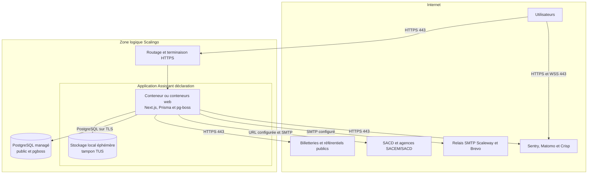

# Architecture physique — Assistant déclaration

## Objet et limite de responsabilité

L’infrastructure physique sous-jacente est administrée par Scalingo et n’est pas accessible à l’équipe projet. Le présent document décrit donc les ressources d’infrastructure exposées au projet : environnements applicatifs, ressources d’exécution, base de données, stockage, réseau, localisation et services externes.

Les centres de données, hyperviseurs, grappes de calcul, équipements réseau, dispositifs physiques de sécurité et mécanismes internes de redondance du prestataire ne sont pas décrits, car aucune information vérifiable à leur sujet n’est versionnée dans le dépôt.

Les composants logiciels sont détaillés dans [l’architecture technique](./architecture-technique.md) et les responsabilités fonctionnelles dans [l’architecture logique](./architecture-logique.md).

## Environnements physiques / d’hébergement

| Environnement                       | Prestataire                            | Région                                                      | Type de service                                                                 | Ressources connues                                                                                  | Données hébergées                                                                                                             |
| ----------------------------------- | -------------------------------------- | ----------------------------------------------------------- | ------------------------------------------------------------------------------- | --------------------------------------------------------------------------------------------------- | ----------------------------------------------------------------------------------------------------------------------------- |
| Développement local                 | Poste du développeur et moteur Docker  | Locale                                                      | Processus Node.js, PostgreSQL et MailCatcher conteneurisés pour les dépendances | PostgreSQL `15.8`, volume Docker persistant, ports paramétrables ; ressources du poste non définies | Données locales ou fictives ; courriels interceptés                                                                           |
| Tests locaux / intégration continue | Poste du développeur ou GitHub Actions | Non applicable / non documentée                             | Exécution éphémère, PostgreSQL lancé par Testcontainers                         | Exécuteur GitHub `ubuntu-24.04` ; processeur détecté dynamiquement pour Jest                        | Jeux de test éphémères                                                                                                        |
| Applications de revue               | Scalingo                               | `osc-fr1`                                                 | Application PaaS et base associée selon la configuration Scalingo               | Type, nombre de conteneurs et plan de base non versionnés                                           | Données temporaires peuplées ; secrets factices fournis par `scalingo.json`                                                   |
| Développement partagé               | Scalingo                               | `osc-fr1`        | Application PaaS et PostgreSQL managé                                           |                     | Données de test annoncées par le `README.md`                                                                                  |
| Production                          | Scalingo                               | `osc-secnum-fr1` | Application PaaS et PostgreSQL managé                                           | 1 instance                                                                         | Comptes, structures, identifiants de raccordement, données de billetterie et de déclaration, pièces jointes, files de travaux |

## Socle système

### Éléments gérés par le projet

| Élément         | Configuration versionnée                               | Observation                                                                                                               |
| --------------- | ------------------------------------------------------ | ------------------------------------------------------------------------------------------------------------------------- |
| Application     | Sortie autonome Next.js exécutée par Node.js `24.21.0` | Un type de processus `web` dans le `Procfile`                                                                             |
| Construction    | Buildpack Node.js Scalingo                             | Référence distante non épinglée à un commit dans `.buildpacks`                                                            |
| Démarrage       | `start-and-wait-to-init.sh`                            | Lance le serveur, vérifie sa disponibilité puis initialise les traitements                                                |
| Migrations      | Prisma `6.10.1` en tâche `postdeploy`                  | Schéma et 24 migrations versionnés                                                                                        |
| File de travaux | `pg-boss` dans le processus applicatif                 | Tables dans PostgreSQL, interrogation toutes les 30 secondes, archives conservées 45 jours                                |
| Planification   | Planificateur `pg-boss`                                | Nettoyage quotidien à 03:00, heure de Paris ; `cron.json` est vide                                                        |
| Pièces jointes  | Tampon local TUS puis colonne `bytea` PostgreSQL       | Le fichier local est supprimé après transfert ; les téléversements incomplets peuvent disparaître lors d’un redéploiement |

### Éléments gérés par Scalingo

- ordonnancement et exécution des conteneurs issus du Buildpack ;
- terminaison et routage HTTP/HTTPS, domaines et certificats associés ;
- service PostgreSQL managé et accès réseau associé ;
- système de fichiers local des conteneurs, considéré comme éphémère par l’application ;
- journaux et notifications de plateforme ;
- sauvegarde du service PostgreSQL selon l’affirmation de l’ancien DAT, à confirmer contractuellement et dans la configuration active.

**À compléter :** système d’exploitation de l’image, classe des conteneurs applicatifs, nombre d’instances, politique de redémarrage, autoscaling, plan PostgreSQL, version exacte du serveur, capacité de stockage, haute disponibilité, adresses de sortie, pare-feu et politique de maintenance du prestataire.

### Services externes

- Sentry pour la collecte d’erreurs et le rejeu de session ;
- Matomo pour la mesure d’audience ;
- Crisp pour le support conversationnel ;
- Scaleway et Brevo, respectivement présentés comme relais SMTP principal et de repli ;
- GitHub Actions et Chromatic pour l’intégration continue et la revue de l’interface ;
- Annuaire des Entreprises et service national de géocodage ;
- billetteries connectées ;
- interface SACD et agences SACD/SACEM ;

## Ressources et dimensionnement

| Ressource                               | Valeur établie dans le dépôt                                                                                                        | État                                                                                                                          |
| --------------------------------------- | ----------------------------------------------------------------------------------------------------------------------------------- | ----------------------------------------------------------------------------------------------------------------------------- |
| Processus de l’application principale   | Type `web` ; Next.js, planificateur et consommateur de travaux dans le même processus logique                                       | Nombre de conteneurs à compléter                                                                                              |
| Mémoire du processus principal          | -                                                                                                                       | 512Mo |
| Unités de calcul du processus principal | -                                                                                                                       | 1 instance, élastique |
| PostgreSQL de développement partagé     | Maximum de 10 connexions                                                                                | 512Mo                                                                                 |
| PostgreSQL de production                | Aucune caractéristique versionnée                                                                                                   | 512Mo |
| Stockage de fichiers                    | PostgreSQL `bytea`, 5 Mio maximum par pièce                                                                                         | Volumétrie faible                                                                               |
| Tampon de téléversement                 | Système de fichiers local éphémère du conteneur                                                                                     | Capacité `tmp` ; ne constitue pas un stockage pérenne                                                        |
| File de travaux                         | Même PostgreSQL, interrogation toutes les 30 secondes, un travail attendu par lot                                                   | Nombre de consommateurs lié au nombre de processus `web`                                                         |
| Intégration continue                    | `NODE_OPTIONS=--max_old_space_size=4096`                                                                                            | Limite du tas Node.js pendant la CI, pas dimensionnement de production                                                        |

## Architecture réseau

L’application est exposée à Internet par le routage Scalingo. 

Le processus applicatif communique avec PostgreSQL au moyen de l’URL fournie par Scalingo, sur un réseau privé. Prisma et `pg-boss` disposent de clients distincts. Le flux Prisma est documenté avec `sslmode=prefer`. Le flux `pg-boss` substitue `sslmode=no-verify` pour contourner un certificat autosigné dans la chaîne.

Tous les connecteurs de billetterie dont l’adresse est construite par le code utilisent HTTPS. Le domaine Supersoniks/SoTicket dépend de la structure raccordée. L’interface SACD est définie par une variable secrète et son schéma n’est pas imposé par le code. Les courriels sortent par deux relais SMTP configurés par environnement.

La [matrice des flux](./architecture-technique.md#matrice-des-flux) recense les destinations et ports connus.

### Cloisonnements connus

- Les environnements de développement et de production sont des applications Scalingo distinctes et isolées.
- Les applications de revue reçoivent un mode test et des secrets factices.
- Les pièces jointes privées exigent un jeton signé à courte durée ; leur contenu pérenne reste dans PostgreSQL.
- La politique de sécurité du contenu limite les origines côté navigateur aux services configurés ou explicitement autorisés.

## Hébergement et localisation

| Service                                       | Localisation documentée dans le dépôt                        |
| --------------------------------------------- | ------------------------------------------------------------ |
| Application et base de développement Scalingo | Région `osc-fr1`                               |
| Application et base de production Scalingo    | Région `osc-secnum-fr1`                     |                
| Sentry `sentry.incubateur.net`                | Tours, Paris  |                   
| Matomo `stats.beta.gouv.fr`                   | Tours, France selon l’ancien DAT  
| Crisp                                         | France                                         |
| SMTP Scaleway                                 | Paris                                           |
| SMTP Brevo                                    | Paris                             | 
| Billetweb, HelloAsso, Mapado, Shotgun         | Non documentée                                               |
| Supersoniks / SoTicket                        | Variable selon le domaine du client                         |
| SACD et agences                               | Destination partiellement confidentielle ou variable        |
| GitHub Actions et Chromatic                   | Non documentée                                               |

## Sauvegarde, redondance et reprise

### Responsabilités Scalingo

Scalingo assure une sauvegarde quotidienne de la base de donnée. La restauration est un processus manuel.

### Mécanismes du projet

- les migrations Prisma versionnent les changements de structure et s’exécutent après déploiement ;
- les données métier, pièces jointes et travaux sont regroupés dans PostgreSQL, ce qui permet une sauvegarde cohérente de l’état applicatif si toutes les tables et tous les schémas sont inclus ;
- les travaux `pg-boss` conservent leurs archives pendant 45 jours ;
- les erreurs de synchronisation et de transmission sont enregistrées dans les entités métier ;
- un point de maintenance permet de rejouer un travail terminé.

## Répartition des responsabilités

| Domaine                                                    | Projet                                           | Scalingo                                        | Service externe                                                                    |
| ---------------------------------------------------------- | ------------------------------------------------ | ----------------------------------------------- | ---------------------------------------------------------------------------------- |
| Code, dépendances, migrations et configuration applicative | Responsable                                      | Exécute les artefacts fournis                   | GitHub héberge le dépôt et la CI                                                   |
| Nombre et classe de conteneurs                             | Demande et configure                             | Fournit et orchestre                            | Sans objet                                                                         |
| Système hôte et image finale                               | Choisit le Buildpack et la version Node.js       | Construit et exploite l’image                   | Buildpack maintenu sur GitHub                                                      |
| Données PostgreSQL et modèle                               | Définit le modèle, les droits et les traitements | Exploite le service managé                      | Sans objet                                                                         |
| Sauvegarde et restauration de la base                      | Définit les exigences et teste                   | Fournit les mécanismes souscrits                | Copie secondaire non mise en œuvre                                                 |
| Domaines et HTTPS                                          | Configure DNS et domaine                         | Termine et route HTTPS selon configuration      | OVH Cloud est cité pour la délégation DNS                                          |
| Secrets applicatifs                                        | Définit, injecte, limite et renouvelle           | Stocke les variables d’environnement            | Fournisseurs émettent leurs identifiants                                           |
| Supervision                                                | Configure alertes et traite les incidents        | Fournit journaux et notifications de plateforme | Sentry, Matomo et autres services traitent leurs flux                              |
| Continuité des partenaires                                 | Gère les erreurs et le repli SMTP                | Sans objet                                      | Billetteries, organismes et messageries restent responsables de leur disponibilité |
