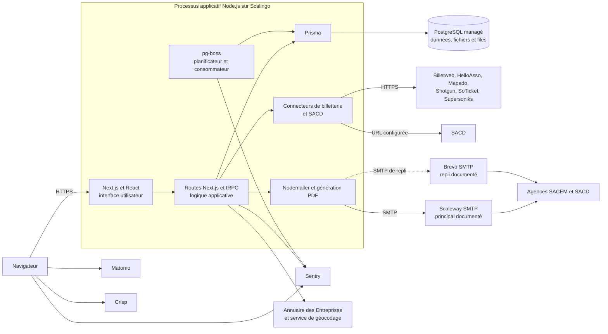
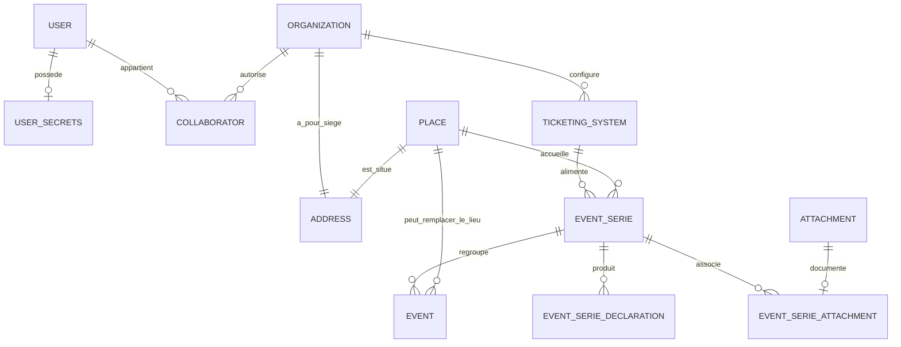

# Architecture technique — Assistant déclaration

## Objet du document

Ce volet décrit la mise en œuvre logicielle d’Assistant déclaration : composants, versions, construction, déploiement, flux, persistance et mesures de sécurité. La vue fonctionnelle figure dans [l’architecture logique](./architecture-logique.md) et l’implantation d’hébergement dans [l’architecture physique](./architecture-physique.md).

Les versions indiquées comme « résolues » proviennent de `package-lock.json`, et non seulement des plages déclarées dans `package.json`. Les caractéristiques d’un service Scalingo non versionnées dans le dépôt sont explicitement laissées à compléter.

## Vue d’ensemble de l’architecture technique

Assistant déclaration est une application Web monolithique modulaire construite avec Next.js et exécutée par Node.js. React et le DSFR composent l’interface utilisateur. La partie serveur expose principalement une interface tRPC, complétée par des routes Next.js pour NextAuth, les téléversements TUS, les fichiers, la synchronisation longue et la maintenance.

La partie serveur accède à PostgreSQL au moyen de Prisma. La même base porte les données métier, les pièces jointes en `bytea` et les tables de `pg-boss`. Le producteur, le planificateur et le consommateur de travaux `pg-boss` s’exécutent dans le même processus applicatif que Next.js ; il ne s’agit pas d’un service de file distinct.

Les appels vers les billetteries, l’Annuaire des Entreprises, le service de géocodage, la SACD et les serveurs SMTP sont émis par la partie serveur. Sentry instrumente le navigateur et le serveur. Matomo et Crisp sont chargés dans le navigateur.

## Schéma d’architecture technique

## Composants applicatifs

| Composant                     | Nature                             | Fonction                                                                                                     | Interne / externe              | Mode de mise en œuvre                                                                 |
| ----------------------------- | ---------------------------------- | ------------------------------------------------------------------------------------------------------------ | ------------------------------ | ------------------------------------------------------------------------------------- |
| Interface Next.js / React     | Application Web                    | Pages publiques et privées, formulaires, tableau de bord                                                     | Interne                        | Rendu serveur et client dans le même projet Next.js                                   |
| API tRPC                      | Interface applicative              | Procédures typées de compte, structure, billetterie, événements et déclarations                              | Interne                        | Route Next.js `/api/trpc`, transformation SuperJSON, validation Zod                   |
| Routes API spécialisées       | Interface HTTP                     | Authentification, TUS, fichiers signés, synchronisation longue, initialisation et maintenance                | Interne                        | Routes historiques Next.js sous `src/pages/api`                                       |
| NextAuth                      | Bibliothèque d’authentification    | Authentification par identifiants et session JWT                                                             | Interne                        | Fournisseur `Credentials`, adaptateur Prisma                                          |
| Couche métier                 | Modules TypeScript                 | Normalisation, contrôles, calculs et orchestration des transmissions                                         | Interne                        | `src/core`, `src/models` et `src/server/routers`                                      |
| Connecteurs de billetterie    | Adaptateurs                        | Lecture et adaptation des données Billetweb, HelloAsso, Mapado, Shotgun, SoTicket et Supersoniks             | Interne vers externe           | Clients `fetch` ou clients générés depuis OpenAPI ; destinations fixes ou paramétrées |
| Connecteur SACD               | Adaptateur                         | Connexion, formatage et transmission à l’interface SACD                                                      | Interne vers externe           | Appels HTTP configurés et charge utile de formulaire/XML                              |
| Transmission SACEM            | Service applicatif                 | Génération du PDF puis envoi à l’agence                                                                      | Interne vers externe           | React PDF, MJML et Nodemailer                                                         |
| Gestion des pièces jointes    | Service applicatif                 | Téléversement reprenable, contrôle de type, stockage et lecture par lien signé                               | Interne                        | Uppy/TUS, tampon local éphémère, `bytea` PostgreSQL, JWT HS256 de 15 minutes          |
| Prisma                        | Couche d’accès aux données         | Client typé, transactions et migrations                                                                      | Interne                        | Client généré à partir de `src/prisma/schema.prisma`                                  |
| PostgreSQL                    | Base relationnelle                 | Données métier, identités, secrets applicatifs, pièces jointes et états de travaux                           | Service managé en exploitation | Extension et version du service distant non fixées dans le dépôt                      |
| pg-boss                       | File de travaux                    | Planification persistante et exécution du nettoyage des téléversements incomplets                            | Interne                        | Bibliothèque exécutée dans le processus Node.js, tables dans PostgreSQL               |
| Sentry                        | Supervision d’erreurs              | Collecte d’erreurs côté navigateur, serveur, ligne de commande et travaux ; rejeu de session côté navigateur | Externe                        | SDK Next.js, DSN et version par environnement                                         |
| Matomo                        | Mesure d’audience                  | Pages vues et événements d’usage                                                                             | Externe                        | SDK chargé dans le navigateur, mode sans témoin demandé dans le code                  |
| Crisp                         | Support utilisateur                | Messagerie instantanée avec identité utilisateur signée                                                      | Externe                        | SDK navigateur chargé à la demande ; signature HMAC calculée côté serveur             |
| Service SMTP principal        | Messagerie                         | Courriels de compte et de déclaration                                                                        | Externe                        | Nodemailer ; Scaleway est désigné comme fournisseur principal dans le `README.md`     |
| Service SMTP de repli         | Messagerie                         | Nouvelle tentative après échec du service principal                                                          | Externe                        | Nodemailer ; Brevo est désigné comme fournisseur de repli dans le `README.md`         |
| Annuaire des Entreprises      | Référentiel public                 | Vérification du SIREN/SIRET et récupération de l’adresse textuelle                                           | Externe                        | API `recherche-entreprises.api.gouv.fr`                                               |
| Service national de géocodage | Référentiel public                 | Structuration de l’adresse du siège                                                                          | Externe                        | API `data.geopf.fr/geocodage/search`                                                  |
| Storybook / Chromatic         | Outil de conception et de contrôle | Catalogue des composants, tests d’interaction, accessibilité et revue visuelle                               | Externe à l’exécution          | Construction Storybook en intégration continue, publication Chromatic                 |

## Socle technique

| Composant / bibliothèque                 | Version                                                                                  | Fonction                                     | Source de l’information                                                      |
| ---------------------------------------- | ---------------------------------------------------------------------------------------- | -------------------------------------------- | ---------------------------------------------------------------------------- |
| Node.js                                  | `24.21.0` ; plage `>=24 <25`                                                             | Environnement d’exécution                    | `.nvmrc`, `package.json`                                                     |
| npm                                      | `11.17.0`                                                                                | Gestionnaire de paquets                      | Champ `packageManager` de `package.json`                                     |
| TypeScript                               | `5.7.2` résolue                                                                          | Langage de l’application                     | `package-lock.json` ; plage `^5.6.2` dans `package.json`                     |
| Next.js                                  | `16.3.3`                                                                                 | Cadriciel Web côté serveur et navigateur     | `package.json`, `package-lock.json`                                          |
| React / React DOM                        | `19.2.0` / `19.2.0`                                                                      | Interface utilisateur                        | `package-lock.json`                                                          |
| Prisma / client Prisma                   | `6.10.1`                                                                                 | Modèle, migrations et accès PostgreSQL       | `package.json`, `Procfile`                                                   |
| tRPC                                     | `11.17.0`                                                                                | Appels typés entre navigateur et serveur     | `package-lock.json`                                                          |
| PostgreSQL                               | `15.8` en développement Docker ; `16.4` dans `.tool-versions` ; exploitation à compléter | Base relationnelle et support de file        | `docker-compose.yaml`, `.tool-versions` ; aucune version distante versionnée |
| pg-boss                                  | `10.1.5`                                                                                 | File de travaux persistante et planification | `package-lock.json`                                                          |
| NextAuth                                 | `4.24.15`                                                                                | Authentification et session JWT              | `package-lock.json`                                                          |
| Zod                                      | `4.1.12` résolue                                                                         | Validation des entrées et modèles            | `package-lock.json`                                                          |
| DSFR / React-DSFR                        | `1.14.4` / `1.25.5` résolues                                                             | Système de design de l’État                  | `package-lock.json`                                                          |
| MUI                                      | `6.4.12` résolue                                                                         | Composants d’interface complémentaires       | `package-lock.json` ; plage `^6.1.10` déclarée                               |
| Sentry Next.js                           | `10.57.0` résolue                                                                        | Supervision et rejeu de session              | `package-lock.json`                                                          |
| Matomo Next                              | `1.9.2` résolue                                                                          | Mesure d’audience                            | `package-lock.json`                                                          |
| Crisp SDK Web                            | `1.0.25` résolue                                                                         | Messagerie de support                        | `package-lock.json`                                                          |
| Nodemailer                               | `7.0.13` résolue                                                                         | Envoi SMTP principal et de repli             | `package-lock.json`                                                          |
| React PDF                                | `4.1.6` résolue                                                                          | Génération du document SACEM                 | `package-lock.json`                                                          |
| MJML                                     | `5.4.1`                                                                                  | Rendu des courriels HTML                     | `package.json`, `package-lock.json`                                          |
| TUS Server                               | `2.0.0`                                                                                  | Téléversement reprenable                     | `package.json`, `package-lock.json`                                          |
| Jest                                     | `29.7.0` résolue                                                                         | Tests unitaires                              | `package-lock.json` ; plage `^29.3.1` déclarée                               |
| Storybook                                | `10.6.0` résolue et corrigée localement                                                  | Catalogue et tests de composants             | `package-lock.json`, `patches/storybook+10.6.0.patch`                        |
| Playwright                               | `1.60.0` résolue                                                                         | Exécution des tests de navigateur Storybook  | `package-lock.json`                                                          |
| axe-playwright / accessibilité Storybook | `2.0.3` / `10.4.4`                                                                       | Contrôles automatisés d’accessibilité        | `package-lock.json`                                                          |
| GitHub Actions                           | Actions épinglées par version majeure                                                    | Intégration continue                         | `.github/workflows/ci.yml`                                                   |
| Buildpack Node.js Scalingo               | branche distante non figée                                                               | Construction et image d’exécution            | `.buildpacks`                                                                |

Les dépendances transitives ne sont pas reproduites ici ; leur résolution complète se trouve dans `package-lock.json`.

## Modalités de construction et de déploiement

### Construction

- Les dépendances sont installées avec `npm install`. Le verrouillage est assuré par `package-lock.json`.
- Le client Prisma est généré avant la compilation.
- `next build --webpack` produit une sortie autonome Next.js. `prepare-standalone.sh` assemble `dist/` avec le serveur, les ressources statiques et le dossier public.
- La construction complète produit aussi Storybook. La commande Scalingo `scalingo-postbuild` ne construit que l’application principale puis prépare la sortie autonome.
- Aucun `Dockerfile` de production n’est présent. `docker-compose.yaml` sert uniquement à fournir PostgreSQL et MailCatcher pour le développement et les tests locaux.

### Intégration continue

Le flux GitHub Actions s’exécute sur Ubuntu 24.04 pour les poussées sur `main` et `dev` ainsi que pour les demandes de fusion. Il réalise : installation, contrôle de synchronisation du client généré Mapado, installation de Chromium, analyse statique ESLint et TypeScript, vérification du formatage, tests unitaires, construction de l’application et de Storybook, tests de navigateur Storybook, puis publication Chromatic hors simulation locale.

Les plans de source Sentry sont téléversés pendant la construction lorsque les secrets GitHub requis sont présents. Le flux ne contient pas de commande de déploiement Scalingo : la documentation indique que l’intégration GitHub de Scalingo observe les branches et déclenche sa propre construction.

### Déploiement et démarrage

- Scalingo utilise le Buildpack Node.js déclaré dans `.buildpacks`.
- Le `Procfile` déclare un seul type de processus applicatif `web` et une commande `postdeploy`.
- `postdeploy` exécute `prisma migrate deploy` avec Prisma `6.10.1` explicitement aligné sur `package.json`.
- Le processus `web` lance `dist/server.js`, attend que le serveur réponde, puis appelle localement `/api/init`. Cette initialisation démarre `pg-boss`, crée sa file si nécessaire, enregistre le consommateur et planifie le nettoyage quotidien à 03:00, heure de Paris.
- `cron.json` ne définit aucun travail Scalingo : la planification courante est applicative et persistée par `pg-boss`.
- Une application de revue reçoit des variables de test et exécute le peuplement initial lors de son premier déploiement via `scalingo.json`.

## Environnements

| Environnement                 | Hébergement                                                            | Région                                                          | Données                                                 | Particularités                                                                                                           |
| ----------------------------- | ---------------------------------------------------------------------- | --------------------------------------------------------------- | ------------------------------------------------------- | ------------------------------------------------------------------------------------------------------------------------ |
| Développement local           | Poste de développement ; PostgreSQL et MailCatcher sous Docker Compose | Poste local                                                     | Données locales ou fictives                             | PostgreSQL `15.8`, ports configurables, envois capturés ; application lancée séparément avec Node.js                     |
| Tests et intégration continue | GitHub Actions et conteneurs de test locaux                            | Infrastructure GitHub non précisée dans le dépôt                | Données éphémères de test                               | Ubuntu 24.04, PostgreSQL lancé par Testcontainers/Docker Compose, mocks externes                                         |
| Applications de revue         | Scalingo                                                               |                                                      | Données temporaires peuplées par le dépôt               | `APP_MODE=test`, secrets factices explicitement limités à ces environnements, Sentry désactivé par configuration fournie |
| Développement partagé         | Scalingo                                                               | `osc-fr1` selon l’ancien DAT ; à confirmer dans Scalingo        | Données de test annoncées par le `README.md`            | Appels billetterie et SACD simulés par défaut ; base documentée avec au plus 10 connexions                               |
| Production                    | Scalingo                                                               | `osc-secnum-fr1` selon l’ancien DAT ; à confirmer dans Scalingo | Données réelles de comptes, billetterie et déclarations | Domaine public et appels externes réels                                                                                  |

Les noms exacts des applications, plans, types et nombres de conteneurs ne sont pas versionnés. Voir [les ressources et le dimensionnement](./architecture-physique.md#ressources-et-dimensionnement).

## Matrice des flux

Les localisations proviennent du dépôt lorsqu’elles y sont indiquées. Une localisation héritée de l’ancien DAT mais non vérifiable dans la configuration est signalée comme telle.

| Source                    | Destination                                     | Finalité                                                            | Protocole                                                   | Port                           | Localisation                                                                                                 | Interne / externe       |
| ------------------------- | ----------------------------------------------- | ------------------------------------------------------------------- | ----------------------------------------------------------- | ------------------------------ | ------------------------------------------------------------------------------------------------------------ | ----------------------- |
| Navigateur                | Application Next.js Scalingo                    | Pages, API, authentification, téléversements et fichiers            | HTTPS                                                       | 443                            | Région de l’environnement Scalingo                                                                           | Interne au service      |
| Navigateur                | Sentry configuré par DSN                        | Erreurs du navigateur et rejeu de session                           | HTTPS                                                       | 443                            |  Tours, Paris | Externe                 |
| Partie serveur et travaux | Sentry configuré par DSN                        | Erreurs serveur, CLI et file de travaux                             | HTTPS                                                       | 443                            |                                                                                                   | Externe                 |
| Navigateur                | Matomo configuré par URL                        | Pages vues et événements                                            | HTTPS attendu par le déploiement                            | 443                            | Tours                                                               | Externe                 |
| Navigateur                | `client.crisp.chat`, relais et stockage Crisp   | Support conversationnel                                             | HTTPS et WSS                                                | 443                            | France                                                                      | Externe                 |
| Partie serveur / Prisma   | PostgreSQL Scalingo                             | Données métier, sessions, secrets de raccordement et pièces jointes | PostgreSQL sur TLS configuré par URL                        |                     | Même région que la base de l’environnement                                                     | Interne à l’hébergement |
| Partie serveur / pg-boss  | PostgreSQL Scalingo                             | Files, planification, verrous et archives de travaux                | PostgreSQL ; `sslmode=no-verify` forcé par le code pg-boss  |                     | Même base que l’application                                                                                  | Interne à l’hébergement |
| Partie serveur            | `recherche-entreprises.api.gouv.fr`             | Vérification de la structure                                        | HTTPS                                                       | 443                            |                                                                                                   | Externe                 |
| Partie serveur            | `data.geopf.fr`                                 | Recherche et structuration d’adresse                                | HTTPS                                                       | 443                            |                                                                                                   | Externe                 |
| Partie serveur            | `www.billetweb.fr`                              | Lecture de billetterie                                              | HTTPS                                                       | 443                            |                                                                                                   | Externe                 |
| Partie serveur            | `api.helloasso.com`                             | Authentification OAuth2 et lecture de billetterie                   | HTTPS                                                       | 443                            |                                                                                                   | Externe                 |
| Partie serveur            | `ticketing.mapado.net`                          | Lecture de billetterie                                              | HTTPS                                                       | 443                            |                                                                                                   | Externe                 |
| Partie serveur            | `smartboard-api.shotgun.live`                   | Lecture de billetterie                                              | HTTPS                                                       | 443                            |                                                                                                   | Externe                 |
| Partie serveur            | Domaine client Supersoniks ou SoTicket          | Lecture de billetterie                                              | HTTPS                                                       | 443                            | Variable selon la structure                                                                                  | Externe                 |
| Partie serveur            | Systèmes de billetterie futurs ou confidentiels | Lecture de billetterie                                              | , HTTPS attendu                                  |                     | Variable                                                                                                     | Externe                 |
| Partie serveur            | Interface SACD définie par `SACD_API_BASE_URL`  | Authentification et transmission de déclaration                     | HTTP(S) selon la variable ; HTTPS à vérifier impérativement | Selon l’URL                    | Destination confidentielle ou non versionnée                                                                 | Externe                 |
| Partie serveur            | SMTP principal, Scaleway selon le `README.md`   | Comptes, notifications, déclarations SACEM et pièces SACD           | SMTP ; protection de transport non explicite dans le code   | 465 | Paris                                                                       | Externe                 |
| Partie serveur            | SMTP de repli, Brevo selon le `README.md`       | Deuxième tentative d’envoi                                          | SMTP ; protection de transport non explicite dans le code   | 587 | Paris                                                                       | Externe                 |
| Serveur SMTP              | Agences SACEM et SACD                           | Remise de déclarations et pièces jointes                            | SMTP entre relais de messagerie                             | Géré par les fournisseurs      | Destinations variables                                                                                       | Externe                 |
| Construction Scalingo     | GitHub                                          | Métadonnées de version pour Sentry                                  | HTTPS                                                       | 443                            | Externe                                                                                                      | Externe                 |
| GitHub Actions            | Sentry et Chromatic                             | Plans de source et Storybook                                        | HTTPS                                                       | 443                            |                                                                                                   | Externe                 |

## Données et persistance

### PostgreSQL et schémas

Prisma utilise le schéma PostgreSQL par défaut, actuellement `public`. Vingt-quatre migrations versionnées couvrent la période de décembre 2024 à décembre 2025. Les migrations sont appliquées automatiquement en `postdeploy`.

`pg-boss` crée et gère son propre schéma et ses tables dans la même base. Le `README.md` identifie ce schéma comme `pgboss`.

Les extensions `uuid-ossp` et `pgcrypto` sont demandées par le `README.md`, mais leur activation n’est pas portée par une migration Prisma. ** :** confirmer leur présence dans chaque base managée et documenter leur nécessité actuelle.

### Vue synthétique du modèle métier

Les entités secondaires d’authentification (`Session`, `Account`, `VerificationToken`), les paramètres Crisp et les référentiels `SacemAgency` et `SacdAgency` ne sont pas affichés pour garder le diagramme lisible.

### Fichiers

Les pièces jointes, limitées à 5 Mio chacune, sont d’abord écrites dans un répertoire local du processus TUS. À la fin du téléversement, leur type est contrôlé, leur contenu est chargé dans la colonne PostgreSQL `Attachment.value` de type `bytea`, puis le fichier local est supprimé. Le système de fichiers local n’est donc qu’un tampon éphémère. Les téléchargements privés nécessitent un lien JWT HS256 signé, valable 15 minutes.

Un travail quotidien supprime les pièces non valides, non associées et âgées d’au moins sept jours. Les archives `pg-boss` sont conservées 45 jours par configuration applicative.

### Sauvegardes

Scalingo réalise des sauvegardes automatiques de la base de données, et la restauration est manuelle.

## Sécurité

### Authentification

L’application utilise NextAuth avec un fournisseur par identifiants. Le mot de passe est haché par bcrypt avec un facteur de coût de 10. L’inscription doit être confirmée par un lien à jeton aléatoire valable 14 jours. Le jeton de réinitialisation est valable 60 minutes. Seuls les comptes au statut `CONFIRMED` peuvent se connecter ; le modèle prévoit aussi les statuts `REGISTERED` et `DISABLED`.

La session applicative suit la stratégie JWT de NextAuth et est signée par `NEXT_AUTH_SECRET`. Aucune authentification multifacteur de l’utilisateur final n’est implémentée.

Le validateur du code impose au moins 8 caractères, une minuscule, une majuscule, un chiffre et un caractère spécial.

### Autorisation et contrôle d’accès

Les procédures privées exigent une session valide. Chaque accès métier à une structure, une billetterie, une série ou une déclaration vérifie ensuite l’existence d’une relation `Collaborator` entre l’utilisateur et la structure. Un utilisateur ne peut créer qu’une structure depuis le parcours courant, bien que le modèle accepte plusieurs appartenances.

### Accès aux infrastructures

L'accès Scalingo est restreint aux développeurs, avec authentification multifacteur obligatoire.

Scalingo assure un journal des déployements qui précise le compte utilisateur qui l'a déclanché.

### Gestion des secrets

Les secrets d’exécution sont injectés par variables d’environnement Scalingo ; les secrets de construction Sentry et Chromatic proviennent des secrets GitHub Actions. Les fichiers modèles documentent les noms sans devoir contenir de valeur réelle. `scalingo.json` contient uniquement des valeurs factices destinées aux applications de revue.

Sont notamment secrets : signature de session, liens de fichiers, maintenance, accès SMTP, signature Crisp, interface SACD et identifiants de billetterie. Les identifiants de billetterie sont enregistrés dans des colonnes texte de PostgreSQL ; aucun chiffrement applicatif de ces colonnes n’est visible. La protection dépend donc du chiffrement et des contrôles d’accès de la base et de l’hébergeur.

### Sécurité des communications

- Le HTTPS est forcé dans Scalingo. Le middleware ajoute HSTS, une politique de sécurité du contenu, `nosniff`, une politique de référent et d’autres en-têtes défensifs.
- Les connecteurs de billetterie connus utilisent HTTPS. Le domaine Supersoniks/SoTicket est fourni par l’utilisateur mais est construit avec le schéma HTTPS.
- L’URL SACD est entièrement paramétrable ; le code ne refuse pas une URL non chiffrée. Sa valeur doit être vérifiée en exploitation.
- Prisma reçoit l’URL de base documentée avec `sslmode=prefer`. Pour `pg-boss`, le code remplace explicitement cette valeur par `sslmode=no-verify` afin d’accepter la chaîne de certificats Scalingo : le trafic est chiffré mais le certificat n’est pas vérifié. Ce compromis doit être suivi comme une dette de sécurité.
- Nodemailer reçoit hôte, port et identifiants mais ne fixe ni `secure`, ni `requireTLS`, ni certificat. La protection réelle dépend donc du port et des capacités du fournisseur. Les ports 465 et 587 de l’ancien DAT ne sont pas versionnés dans la configuration actuelle.
- Les pièces jointes privées sont servies par URL signée à courte durée et cache privé.

### Journalisation et supervision

Sentry est initialisé côté navigateur, Node.js, environnement Edge, CLI et travaux. Les corps de requêtes captés sont remplacés par une valeur masquée. Le rejeu de session est configuré avec un taux de 100 % des sessions et de 100 % en cas d’erreur ; il masque toutes les saisies et bloque Crisp ainsi que des éléments métier annotés. L’identifiant interne de l’utilisateur est toutefois associé à la session Sentry.

La journalisation standard produit les événements de synchronisation, de travaux, d’envoi et d’erreur dans les journaux du processus. Prisma limite ses journaux aux erreurs en production. Matomo mesure les pages et certains événements côté navigateur en demandant un fonctionnement sans témoin de connexion.

### Gestion des vulnérabilités et dépendances

GitHub Actions vérifie compilation, formatage, tests et construction. Les alertes CVE de GitHub et les alertes partagées par BetaGouv sont surveillées manuellement, sans mise à jour automatique systématique.

Une analyse statique de code est assurée par Snyk, via un clone du dépôt git dans le Gitlab du Ministère.

### Sauvegarde et intégrité

L’application utilise transactions, contraintes relationnelles, index uniques, validations Zod et verrou transactionnel de synchronisation. Les migrations Prisma sont appliquées après déploiement. Les états et erreurs de synchronisation et de transmission sont conservés en base ; les travaux `pg-boss` sont persistants et archivés 45 jours.

Les sauvegardes de la base, leur chiffrement, leur fréquence et leurs tests de restauration relèvent de Scalingo.

### Données à caractère personnel

La politique de confidentialité versionnée identifie les données de compte et de déclaration, le SNUM du ministère de la Culture comme responsable de traitement, Scalingo comme sous-traitant d’hébergement et une conservation annoncée de deux ans après la dernière activité pertinente. Le code conserve aussi des identifiants de billetterie, pièces jointes, traces de déclaration, paramètres de support et données d’activité.

Aucun traitement automatique de purge à deux ans n’a développé à ce jour.
